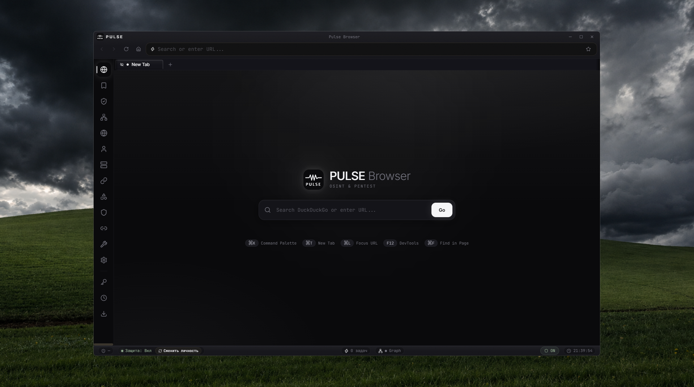
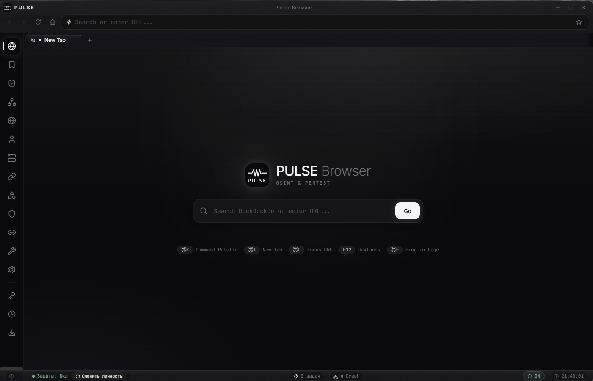

<p align="center">
  
</p>

<h1 align="center">Pulse Browser</h1>

<p align="center">
  <b>OSINT & Pentest Browser</b> — настольный браузер со встроенной панелью разведки, анализа сети и безопасности.<br/>
  Desktop browser with a built-in reconnaissance, network and security toolkit.
</p>

<p align="center">
  <a href="#-возможности--features">Возможности</a> ·
  <a href="#-быстрый-старт--quick-start">Быстрый старт</a> ·
  <a href="#-структура-проекта--project-structure">Структура</a> ·
  <a href="#-лицензия--license">Лицензия</a>
</p>

<p align="center">
  
</p>

---

## 🇷🇺 Русский

### О проекте

**Pulse Browser** — Windows-first десктопный браузер на Electron с боковой панелью OSINT-, reconnaissance- и security-инструментов. Это полноценный рабочий браузер (вкладки, URL-bar, закладки, история, загрузки, приватный режим), а не UI-макет: сетевые операции, сканирование, DNS/ARP, whois и Tor-маршрутизация реализованы в Electron main process.

**Авторизация не требуется** — приложение запускается сразу без логина и пароля, учётные записи и облака нет.

### Возможности

**Браузер**
- Вкладки (обычные и приватные), drag-and-drop, закрытие/восстановление вкладок
- URL-bar с автопоиском (без протокола → DuckDuckGo), навигация, история
- Закладки (импорт/экспорт), панель закладок, менеджер закладок
- Загрузки, панель загрузок, модалка истории
- Command Palette (`Ctrl+K`), горячие клавиши, контекстные меню
- New Tab `pulse://newtab` с quick links
- Сохранение сессии вкладок, превью вкладок

**Приватность**
- Ad blocker с per-site статистикой и категориями (ads, analytics, social, crypto)
- Privacy Dashboard: заблокированные запросы и статистика по сайтам
- Tor-маршрутизация через встроенный privacy helper (SOCKS5, New Identity)
- Ротация User-Agent, приватные session partitions
- Режим инкогнито для вкладок

**OSINT / Recon**
- Domain Intel, Person Intel, IP Intel, Web Intel
- Subdomain Enum, Vuln Scanner, HTTP Client (REST)
- Network: топология сети, ARP, DNS resolve/reverse, ping, traceroute, скан портов
- OSINT Lookup и реестр модулей (Crypto Wallet, Certificate Transparency, Shodan, VirusTotal, EmailRep, AbuseIPDB и др.)
- Cyber Tools: JWT decoder, hash tools и другие security-утилиты
- Canvas — доска для визуальной сборки связей
- Request Inspector и граф сетевых запросов

**Безопасность данных**
- Password Manager: локальное хранилище, шифруется через OS-backed `safeStorage`
- Автозаполнение паролей на страницах
- API-ключи хранятся локально в Settings

### Стек

| Слой | Технологии |
|---|---|
| Desktop | Electron, React 19, TypeScript 5, Vite 5 |
| UI | Tailwind CSS 3, lucide-react, framer-motion, @xyflow/react |
| Тесты | Vitest |
| Сборка | electron-builder (NSIS, portable, AppImage, deb) |

### Быстрый старт

```bash
git clone <repo-url>
cd pulse-browser
npm install
npm run dev          # только renderer на http://localhost:5173
npm run electron:dev # полноценный desktop-режим (Vite + Electron)
```

### Команды

| Команда | Описание |
|---|---|
| `npm run dev` | Vite dev server |
| `npm run electron:dev` | Vite + Electron одновременно |
| `npm run build` | Typecheck + production-сборка renderer |
| `npm run start` | Запуск собранного приложения |
| `npm run electron:build` | Установщик через electron-builder |
| `npm run typecheck` | Проверка типов |
| `npm test` | Тесты (Vitest) |

> **Сборка установщика:** `electron:build` ожидает файлы Tor (`Tor Browser/Browser/TorBrowser/Tor/tor.exe`, `geoip`, `geoip6`) — они не входят в git. Скачай Tor Browser локально и скопируй их перед сборкой, либо убери `extraResources` из `package.json`.

### Структура проекта

```text
pulse-browser/
├── src/                    # React renderer
│   ├── App.tsx             # главный state container и маршрутизация
│   ├── pages/              # браузер + tool-страницы (Recon, Network, OSINT…)
│   ├── components/         # UI: вкладки, sidebar, palette, inspector…
│   ├── lib/                # адаптеры, OSINT-модули, детекторы, настройки
│   ├── network/            # сбор и классификация сетевых запросов
│   └── graph/              # модель и layout графа сети
├── electron/               # main process, preload, adblocker, Tor proxy
├── build/                  # иконки и логотипы
├── vite.config.ts          # Vite
├── vitest.config.ts        # Vitest
└── package.json            # скрипты и electron-builder config
```

---

## 🇬🇧 English

### About

**Pulse Browser** — a Windows-first desktop browser built with Electron, featuring a sidebar of OSINT, reconnaissance and security tools. It is a real working browser (tabs, URL bar, bookmarks, history, downloads, private mode), not a mockup: networking, scanning, DNS/ARP, whois and Tor routing are implemented in the Electron main process.

**No account required** — the app starts immediately without a login or password; there is no cloud or registration.

### Features

**Browser**
- Tabs (normal and private), drag-and-drop, tab restore
- URL bar with smart search (no protocol → DuckDuckGo), navigation, history
- Bookmarks (import/export), bookmarks bar and manager
- Downloads, history modal, command palette (`Ctrl+K`), keyboard shortcuts, context menus
- New Tab `pulse://newtab` with quick links
- Tab session persistence with previews

**Privacy**
- Ad blocker with per-site statistics (ads, analytics, social, crypto categories)
- Privacy Dashboard: blocked requests and per-site stats
- Tor routing via the bundled privacy helper (SOCKS5, New Identity)
- User-Agent rotation, private session partitions, incognito tabs

**OSINT / Recon**
- Domain Intel, Person Intel, IP Intel, Web Intel
- Subdomain Enum, Vuln Scanner, HTTP Client (REST)
- Network: topology view, ARP, DNS resolve/reverse, ping, traceroute, port scanning
- OSINT Lookup with a module registry (crypto wallets, Certificate Transparency, Shodan, VirusTotal, EmailRep, AbuseIPDB and more)
- Cyber Tools: JWT decoder, hash utilities and other security helpers
- Canvas board for visual link building
- Request Inspector and network request graph

**Data security**
- Password Manager: local storage encrypted via OS-backed `safeStorage`
- Password autofill on pages
- API keys stored locally in Settings

### Tech stack

| Layer | Technologies |
|---|---|
| Desktop | Electron, React 19, TypeScript 5, Vite 5 |
| UI | Tailwind CSS 3, lucide-react, framer-motion, @xyflow/react |
| Tests | Vitest |
| Packaging | electron-builder (NSIS, portable, AppImage, deb) |

### Quick start

```bash
git clone <repo-url>
cd pulse-browser
npm install
npm run dev          # renderer only on http://localhost:5173
npm run electron:dev # full desktop mode (Vite + Electron)
```

### Commands

| Command | Description |
|---|---|
| `npm run dev` | Vite dev server |
| `npm run electron:dev` | Vite + Electron together |
| `npm run build` | Typecheck + production renderer build |
| `npm run start` | Run the built app |
| `npm run electron:build` | Installer via electron-builder |
| `npm run typecheck` | Type checking |
| `npm test` | Tests (Vitest) |

> **Building the installer:** `electron:build` expects Tor files (`Tor Browser/Browser/TorBrowser/Tor/tor.exe`, `geoip`, `geoip6`), which are not in git. Download Tor Browser locally and copy them before building, or remove `extraResources` from `package.json`.

### Project structure

```text
pulse-browser/
├── src/                    # React renderer
│   ├── App.tsx             # main state container and routing
│   ├── pages/              # browser + tool pages (Recon, Network, OSINT…)
│   ├── components/         # UI: tabs, sidebar, palette, inspector…
│   ├── lib/                # adapters, OSINT modules, detectors, settings
│   ├── network/            # network request collection and classification
│   └── graph/              # network graph model and layout
├── electron/               # main process, preload, adblocker, Tor proxy
├── build/                  # icons and logos
├── vite.config.ts          # Vite
├── vitest.config.ts        # Vitest
└── package.json            # scripts and electron-builder config
```

---

## 📸 Screenshots / Скриншоты

**New Tab** — стартовая страница с поиском и горячими клавишами:



---

## ⚠️ Disclaimer / Предупреждение

Разведывательные и security-функции допускаются к использованию **только против систем, на которые у пользователя есть разрешение**. Авторы не несут ответственности за использование в незаконных целях. Tor-маршрутизация и смена User-Agent не гарантируют полную анонимность.

Reconnaissance and security features may only be used **against systems you have permission to test**. The authors are not responsible for any misuse. Tor routing and User-Agent rotation do not guarantee complete anonymity.

## 📄 Лицензия / License

Distributed under the **GNU General Public License v3.0** — see [LICENSE](LICENSE).

## © Sokolxv Team
